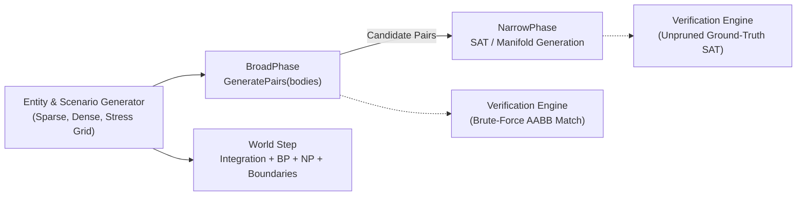

# Elysium Engine Physics Benchmarking Suite (`PhysicsBenchmark`)

The **Elysium Engine Physics Benchmarking Suite** is a dedicated, reproducible, high-precision C++ benchmarking harness designed to establish baseline performance metrics and track algorithmic and SIMD/memory layout optimizations across Elysium Engine's 2D physics subsystem (`engine/physics/`).

---

## 1. Architecture & Benchmark Stages

The benchmark suite isolates and evaluates three key stages of the physics simulation pipeline:



1. **BroadPhase Phase**: Measures spatial grid hashing and candidate pair generation time (`BroadPhase::GeneratePairs`). Records the total candidate pairs detected and asserts exact equivalence against an $O(N^2)$ brute-force AABB check.
2. **NarrowPhase Phase**: Measures geometric intersection and SAT (Separating Axis Theorem) manifold generation on candidate pairs (`NarrowPhase::ResolveCollision` / `NarrowPhase::TestCollision`). Tracks bounding-radius early-out rejections, SAT projection calculations, and confirmed actual collisions.
3. **Physics World Step**: Measures the complete end-to-end `PhysicsWorld::Step(dt)` execution time, including force accumulation, semi-implicit Euler integration, broadphase pruning, narrowphase SAT collision response with friction and restitution impulses, and world boundary containment.

---

## 2. Benchmark Scenarios & Distributions

### Density Distributions
- **Sparse Distribution**: Entities are spread across a wide area scaled with $\sqrt{N}$ (e.g. $[ -L/2, L/2 ]$). Collision candidate pairs are low, emphasizing spatial hash sparsity and minimal narrowphase load.
- **Dense / Clustered Distribution**: Entities are tightly packed in a constrained bounding area. Generates high candidate pair counts and dense overlapping contacts, stressing spatial hash bucket collision resolution and narrowphase SAT throughput.
- **Stress Grid**: An $M \times K$ regular lattice combining static obstacles (`isStatic = true`, $m^{-1} = 0$) and dynamic bodies (`isStatic = false`, $m^{-1} = 1.0$), with small gaps triggering proximity checks.

### Shape Combinations
- **Sphere vs. Sphere**: Analytic distance squared test.
- **Box vs. Box**: Oriented bounding box SAT testing with 4 projection axes.
- **Box vs. Sphere**: Hybrid SAT circle-polygon projection testing with edge normals and vertex axis.
- **Mixed**: Randomized distribution of Circles, Boxes, and regular 5-sided convex Polygons.

### Parametric Entity Scaling Sweeps
Sweeps entity counts $N \in \{100, 500, 1000, 2500, 5000\}$ to measure algorithmic time complexity curves across orders of magnitude.

---

## 3. Building the Benchmark Suite

The benchmark harness is built using CMake and is enabled via `-DBUILD_BENCHMARKS=ON` or `-DBUILD_TESTING=ON`.

### Release Build (Recommended for Accurate Benchmarks)
```bash
# Configure with Release optimization (-O3 -DNDEBUG)
cmake -B build-bench -DCMAKE_BUILD_TYPE=Release -DBUILD_BENCHMARKS=ON

# Compile the PhysicsBenchmark target
cmake --build build-bench --target PhysicsBenchmark -j$(nproc)
```

The resulting binary will be placed in `build-bench/bin/PhysicsBenchmark`.

---

## 4. Command-Line Reference

```
Usage: ./build-bench/bin/PhysicsBenchmark [options]

Options:
  -b, --benchmark=<target>     Target to benchmark: broadphase, narrowphase, world, all (default: all)
  -d, --distribution=<dist>    Distribution: sparse, dense, grid, all (default: all)
  -s, --shapes=<type>          Shapes: sphere, box, box-sphere, mixed, all (default: all)
  -n, --sizes=<list>           Comma-separated body counts (default: 100,500,1000,2500,5000)
  -i, --iterations=<N>         Number of timing iterations per benchmark (default: 20)
  -w, --warmup=<N>             Number of warmup iterations (default: 5)
  -f, --format=<fmt>           Output format: console, json, csv, all (default: console)
  -o, --out=<filepath>         File to write output to (stdout if omitted)
  -v, --verify                 Run baseline correctness verification checks
  --seed=<uint>                RNG seed for reproducibility (default: 42)
  -h, --help                   Display help message and exit
```

---

## 5. Usage Examples

### 1. Quick Verification & Sanity Check
Runs a fast smoke-test with 5 iterations and verifies broadphase and narrowphase correctness:
```bash
./build-bench/bin/PhysicsBenchmark --sizes=100,500 --iterations=5 --warmup=2 --verify
```

### 2. Isolated BroadPhase Benchmark across Distributions
```bash
./build-bench/bin/PhysicsBenchmark --benchmark=broadphase --sizes=100,500,1000,2500 --iterations=25
```

### 3. Isolated NarrowPhase Benchmark on Mixed Shapes
```bash
./build-bench/bin/PhysicsBenchmark --benchmark=narrowphase --shapes=mixed --sizes=500,1000 --verify
```

### 4. Full Parametric Sweep Exporting to JSON & CSV
Runs complete sweep across all distributions and shapes, exporting to `baseline_metrics.json` and `baseline_metrics.csv`:
```bash
./build-bench/bin/PhysicsBenchmark \
  --sizes=100,500,1000,2500,5000 \
  --iterations=15 \
  --warmup=3 \
  --verify \
  --format=all \
  --out=baseline_metrics.json
```

---

## 6. Output Formats

### Console Output
Presents a colorized, aligned tabular breakdown with sample statistics:
```
========================================================================================================================
                                      ELYSIUM ENGINE PHYSICS BENCHMARK REPORT                                            
========================================================================================================================
Phase       Distribution Shapes         N         Mean (us) StdDev (us)    Min (us)    Max (us) CandPairs SATChecks Collisions   Status  
------------------------------------------------------------------------------------------------------------------------
BroadPhase  sparse       sphere_sphere  1000          220.1         5.2       215.3       231.0         4         0          0   PASSED
NarrowPhase dense        box_box        1000         4120.5        88.4      4012.3      4290.1      7810      5912       3910   PASSED
WorldStep   stress_grid  mixed          1000         1180.2        25.1      1150.4      1220.8       850       540         62   PASSED
```

### JSON Schema (`--format=json` or `--format=all`)
Structured JSON containing test metadata, environment details, and per-benchmark records:
```json
{
  "benchmark_metadata": {
    "suite": "ElysiumEngine Physics Subsystem",
    "timestamp": "2026-11-08T09:27:50Z",
    "iterations": 15,
    "warmup_runs": 3,
    "verified": true
  },
  "records": [
    {
      "phase": "BroadPhase",
      "distribution": "dense",
      "shape_config": "box_box",
      "entity_count": 1000,
      "iterations": 15,
      "mean_us": 6230.40,
      "stddev_us": 85.20,
      "min_us": 6120.10,
      "max_us": 6410.50,
      "median_us": 6215.00,
      "ops_per_sec": 160.50,
      "candidate_pairs": 7810,
      "sat_checks": 0,
      "actual_collisions": 0,
      "verified": true,
      "verification_notes": "Broadphase exact match against brute-force (7810 pairs)"
    }
  ]
}
```

---

## 7. Baseline Tracking & CI Comparison Workflow

To verify performance gains and ensure zero algorithmic regressions across optimization branches (e.g. spatial hashing hash-function tuning, SIMD vertex transformation, bounding volume hierarchies, or cache-coherent body arrays):

### Step 1: Record Baseline Metrics on `main`
```bash
git checkout main
cmake -B build-bench -DCMAKE_BUILD_TYPE=Release -DBUILD_BENCHMARKS=ON
cmake --build build-bench --target PhysicsBenchmark -j
./build-bench/bin/PhysicsBenchmark --format=json --out=baseline_main.json --verify
```

### Step 2: Record Metrics on Optimization Branch
```bash
git checkout feature/physics-simd-broadphase
cmake --build build-bench --target PhysicsBenchmark -j
./build-bench/bin/PhysicsBenchmark --format=json --out=optimized_branch.json --verify
```

### Step 3: Compare Results using Python
Use the snippet below to compute speedups and assert collision count equivalence:

```python
import json, sys

with open("baseline_main.json") as f:
    base = {f"{r['phase']}_{r['distribution']}_{r['shape_config']}_{r['entity_count']}": r for r in json.load(f)["records"]}

with open("optimized_branch.json") as f:
    opt = {f"{r['phase']}_{r['distribution']}_{r['shape_config']}_{r['entity_count']}": r for r in json.load(f)["records"]}

print(f"{'Benchmark Identifier':<45} | {'Base (us)':<10} | {'Opt (us)':<10} | {'Speedup':<8} | {'Correctness'}")
print("-" * 90)

for key, b_rec in base.items():
    if key in opt:
        o_rec = opt[key]
        speedup = b_rec["mean_us"] / o_rec["mean_us"]
        pair_match = b_rec["candidate_pairs"] == o_rec["candidate_pairs"]
        col_match = b_rec["actual_collisions"] == o_rec["actual_collisions"]
        status = "PASSED" if (pair_match and col_match) else "REGRESSION"
        print(f"{key:<45} | {b_rec['mean_us']:>10.1f} | {o_rec['mean_us']:>10.1f} | {speedup:>7.2f}x | {status}")
```

If `status` reports `REGRESSION`, an optimization altered collision counts or missed potential pairs.
